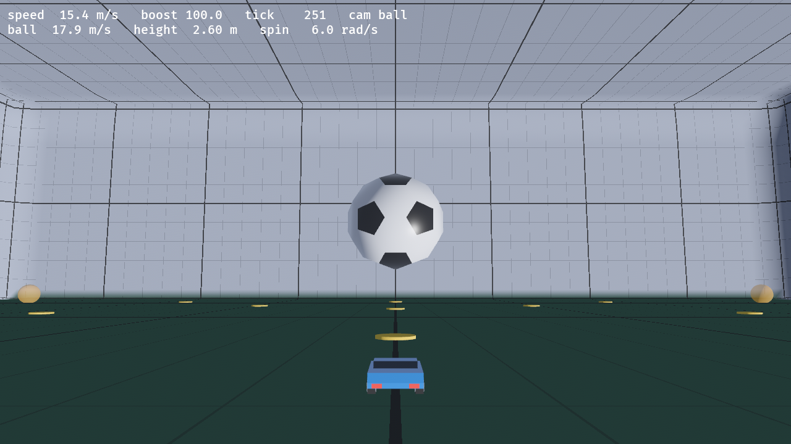

# RL

A Rocket League-like game: a Bevy 3D viewer running
**[RocketSim](https://github.com/ZealanL/RocketSim)** (the pure-Rust v3) for
physics, drawing RocketSim's own arena collision mesh.



_The Bevy viewer at tick 250: the car driving into the ball in front of the goal._

See **[docs/PHYSICS.md](docs/PHYSICS.md)** for the retired hand-rolled `rl`
simulation — why it was written by hand, what it modelled, and honest caveats
about determinism and performance. It is kept as a write-up; it is not the game's
physics.

## Play it in 3D (Bevy)

```sh
cargo run -p rl_view             # already built: starts in about a second
cargo run --release -p rl_view   # smoother, but the first run rebuilds Bevy
```

The dev profile is set up to be playable (this crate at `opt-level = 1`, all
dependencies at `opt-level = 3`), so plain `cargo run` is the one to reach for.

### Play against an RLBot v5 bot

The viewer can expose the bot-facing half of RLBot v5 over TCP, so ordinary
RLBot v5 bots can connect directly to the RocketSim simulation. RLBotServer,
Rocket League and the closed-source `Bridge.dll` are **not** involved.

```sh
# terminal 1: human on Blue, a bot slot on Orange, listening on 23234
cargo run -p rl_view -- --rlbot

# terminal 2: install the v5 Python interface (the stable `rlbot` on PyPI is
# still v4, so ask pip for the pre-release) and connect the test bot
python3 -m venv /tmp/rlbot-venv
/tmp/rlbot-venv/bin/pip install --pre "rlbot==2.0.0b56"
RLBOT_SERVER_IP=127.0.0.1 RLBOT_SERVER_PORT=23234 \
  RLBOT_AGENT_ID=rlbot/opponent \
  /tmp/rlbot-venv/bin/python tools/rlbot_test_bot.py
```

The viewer can also start the bot itself, so no second terminal is needed:

```sh
# A bot name from the installed botpack is enough: it is matched against the
# bot's directory, config filename, display name and agent id. A bot directory
# or a bot.toml path works too.
cargo run -p rl_view -- --rlbot --rlbot-config Nexto
cargo run -p rl_view -- --rlbot \
  --rlbot-config ~/.local/share/RLBot5/bots/bob_build_x86_64-linux/Nexto/bot.toml

# Or run any shell command. The viewer supplies RLBOT_SERVER_IP,
# RLBOT_SERVER_PORT and RLBOT_AGENT_ID in its environment.
cargo run -p rl_view -- --rlbot --rlbot-command "python src/bot.py" --rlbot-dir /tmp/bot
```

A bare name is looked up under the RLBot botpack root, `$XDG_DATA_HOME/RLBot5/bots`
(or `~/.local/share/RLBot5/bots`) on Linux and `%LOCALAPPDATA%\RLBot5\bots` on
Windows. It is case-insensitive and accepts `Nexto`, `rlgym/nexto`, `nexto`, …;
if two bots match, the viewer lists them instead of guessing.

`--rlbot-config` reads the `[settings]` section (`name`, `agent_id`,
`run_command_linux`/`run_command`, `root_dir`, `environment`) and adds the
botpack's shared `torch-archive` to `LD_LIBRARY_PATH` when it finds one, which
is what the RLBot GUI does for ML bots. Explicit `--rlbot-agent-id` and
`--rlbot-name` override the config. Either launch flag implies `--rlbot`, and
the bot process is killed when the viewer exits.

The bot sees the normal `MatchConfiguration`, `FieldInfo`, `GamePacket` and
(if it asks) `BallPrediction`, and sends `PlayerInput` back. `tools/rlbot_test_bot.py`
is deliberately tiny; a real bot connects the same way. Useful flags:

| Flag                  | Meaning                                                                 |
| --------------------- | ----------------------------------------------------------------------- |
| `--rlbot`             | Start the bridge and add an Orange opponent.                            |
| `--rlbot-port PORT`   | TCP port (default `23234`).                                             |
| `--rlbot-agent-id ID` | Agent id the bot must announce (default `rlbot/opponent`).              |
| `--rlbot-name NAME`   | Display name in the match configuration (default `RLBot`).              |
| `--rlbot-command CMD` | Shell command to start as the bot. Implies `--rlbot`.                   |
| `--rlbot-config SPEC` | Bot name, directory or `bot.toml` to read and start. Implies `--rlbot`. |
| `--rlbot-dir DIR`     | Working directory for the launched bot (defaults to its toml's).        |

The [RLBot GUI](https://rlbot.org/) is the easiest way to get compiled bots
without setting up each bot's runtime: its official botpack installs to
`~/.local/share/RLBot5/bots` on Linux, and every bot has a `*.bot.toml` or
`bot.toml` that `--rlbot-config` can read. The GUI's own "Start Match" cannot
drive this viewer (it talks to RLBotServer), and RLBotServer occupies port
23234, so quit the GUI before playing against the bridge or start the viewer
with a different `--rlbot-port`.

The bridge is deliberately an MVP: one bot, no match orchestration, no
debug rendering, match comms or state setting, and a `Kickoff` phase that lasts
one second after every reset. The RLBot v5 protocol is still pre-release, so
pin a client version you have tested.

### RocketSim physics

The viewer's physics come from
**[RocketSim v3](https://github.com/ZealanL/RocketSim/tree/v3-rust)**, a
pure-Rust rewrite of RocketSim, pinned in `view/Cargo.toml` to a git revision
(it is not published on crates.io yet). RocketSim collides the ball against
Rocket League's _actual_ arena mesh, loaded once from `./collision_meshes/` at
startup, so the viewer needs those files to run:

```sh
# one-time: dump RL's arena collision meshes, then put the `.cmf` files in
# RL/collision_meshes/soccar/ (next to the workspace root):
#
#   Linux / Proton:  sudo python3 tools/rlacd.py    # this repo's port; see the
#                                                   # header of tools/rlacd.py
#   Windows:         https://github.com/ZealanL/RLArenaCollisionDumper
```

Without them the viewer exits immediately with a message saying so. RocketSim
reports positions in "uu" (1 uu = 1 cm, so /100 for metres), Z-up, `+X` forward;
`view/src/sim.rs` rotates that into the viewer's Y-up frame and is the only place
that knows about RocketSim. The drawn arena is RocketSim's own collision mesh, so
the visible surface _is_ the surface you collide with.

The hand-rolled `rl` simulation that used to be the workspace root has been
retired; `docs/PHYSICS.md` is kept as a write-up of it. The viewer gets its
cosmetic constants (ball/car mesh sizes, goal frame) from RocketSim too, in
`view/src/sim.rs`.

| Key                       | Gamepad           | Action             |
| ------------------------- | ----------------- | ------------------ |
| `W` `A` `S` `D` or arrows | left stick        | drive              |
| `I` `J` `K` `L`           | right stick       | look around        |
| -                         | right stick click | look behind        |
| `ctrl`                    | `A`               | jump               |
| `space`                   | `B`               | boost              |
| `shift`                   | `X`               | drift (handbrake)  |
| `Q` / `E`                 | hold `X` + stick  | air roll           |
| `C`                       | `Y`               | camera (ball/car)  |
| `R`                       | `start`           | reset car and ball |
| `esc`                     | -                 | quit               |

Keyboard and pad are merged per axis, so either works and holding both does not
cancel out. Bindings live in `controls.toml` and are hot-reloaded when you save;
pass `--controls-config PATH` to use another file. Missing entries keep the
defaults shown above, and any action can take one key/button or a list. On the
pad the triggers are analogue throttle: pull the right trigger
to accelerate, the left to reverse. Boost (`space` / `B`) is replenished by the
boost pads on the pitch — six big pads (full tank, shown as translucent orbs)
and 28 small ones (flat discs). They cannot be taken at a full tank, and vanish
while on cooldown. Jump (`ctrl` / `A`) is edge-triggered, and
pressing it again while airborne gives a double jump — or, with the stick held
off centre, a **flip**. The drive stick doubles as air control: stick up is a
frontflip, stick left yaws left, and `Q`/`E` (or `X`/`B`-style drift + stick)
rolls. `controls.toml` can also bind dedicated pad `roll_left`/`roll_right`
buttons, which work alongside drift + stick. The right stick (or `IJKL`) swivels
the camera and pitches it, and
clicking the right stick in (`R3`) looks behind you; everything springs back when
released. (If your pad reports nothing, see the gamepad section under "A note on
Bevy's features" below.)

The camera follows Rocket League's model rather than the old car-frame boom:
the boom is world-upright, a fixed distance behind and height above the car, and
only its yaw tracks the car. RL's camera angle pitches the _view_, not the boom,
so the car sits low in the frame. In ball cam (the default) the yaw follows the
horizontal bearing to the ball; `Y` (or `C`) switches to a straight-ahead car
cam. The camera is not clipped to the arena — because the shell is one-sided it
may sit outside and look back in — so wall play stays visible. Camera settings
live in `camera.toml` (RL defaults: 110° FOV, 270 uu distance, 100 uu height, -4°
angle, 0.5 stiffness; metres in the file, ×100 for the in-game `uu` values) and
are hot-reloaded when you save. Pass `--camera-config PATH` to use another file.
Keyboard and gamepad bindings live in `controls.toml`, with the same optional,
hot-reloaded treatment (`--controls-config PATH` to override). This needs a GPU
and a window; it was developed on Vulkan.

The arena is drawn straight from RocketSim's own collision mesh — the very
geometry the ball and car collide with — so what you see is what you hit. A
repeating 2 m grid (with a heavier 10 m major grid) is projected onto every
surface so you can read distances, including the rounded wall-to-ceiling joins.
Every face is drawn one-sided, facing inward, so from outside the shell reads as
a cage you can see through — which is what lets the camera leave it (see above).
Both ends carry a full-size Soccar goal, carved into the mesh, with the goal frame
in team colours (blue at -Z, orange at +Z); the ball scores when it crosses the
line, with the score on the HUD. The ball is a proper football (black pentagons
and white hexagons), so its spin reads, and the car is a sedan-shaped mesh sized
to the Octane hitbox, with wheels that roll and steer. You can drive up the walls
and across the ceiling.

### From Zed

`.zed/tasks.json` defines all of the commands below as project tasks, so you
don't have to remember them. Run `task: spawn` (`cmd-shift-p` → "task: spawn")
and pick one, or `task: rerun` to repeat the last one.

| Task                                  | What it does                                       |
| ------------------------------------- | -------------------------------------------------- |
| `RL: play 3D (Bevy)`                  | the viewer                                         |
| `RL: play 3D (Bevy, RLBot slot)`      | the viewer with a bot slot on port 23234           |
| `RL: play 3D (Bevy, release)`         | same, optimised (first run rebuilds Bevy: minutes) |
| `RL: play 3D (Bevy, gamepad debug)`   | viewer, plus a log of every pad event              |
| `RL: gamepad probe (mapping report)`  | how gilrs mapped the connected pad                 |
| `RL: run tests`                       | `cargo test --workspace`                           |
| `RL: cargo check`                     | type-check the workspace on demand (see below)     |
| `RL: clippy (workspace, all targets)` | lints                                              |
| `RL: render screenshot (tick 250)`    | dump a frame to `docs/screenshot.png`              |
| `RL: render free-cam shot (no sim)`   | instant shot from a fixed angle to `docs/shot.png` |

To put one on a key, add to your `keymap.json`:

```json
{
  "context": "Workspace",
  "bindings": {
    "alt-r": [
      "task::Spawn",
      { "task_name": "RL: play 3D (Bevy)", "reveal_target": "center" }
    ]
  }
}
```

(Note `reveal_target` belongs in the keybinding, not the task definition.)

### Why rust-analyzer is not allowed to check on save

`.zed/settings.json` sets two rust-analyzer options for this project:

- `checkOnSave: false` — by default rust-analyzer runs
  `cargo check --workspace --all-targets` on every save. With Bevy in the
  workspace that re-checks a large dependency tree on each save and pegs the CPU.
- `cargo.targetDir: true` — rust-analyzer gets its own target directory
  (`target/rust-analyzer`) instead of sharing `target/`. Cargo holds an
  exclusive lock on the target directory while building, so without this
  rust-analyzer's check and a `cargo build`/`cargo run` block each other: whichever
  started second waits for the other's lock.

Together these stop the auto-check churn and the lock contention. When you do want
cargo's diagnostics, run the `RL: cargo check` task — its output is clickable.

You can also have it render a single frame and exit, which is handy for CI or
for eyeballing a change:

```sh
cargo run -p rl_view -- --screenshot shot.png 250
#                                     path      tick to capture
```

That runs the self-driving script up to the tick and shoots the chase camera, so
the pose is a _dynamic_ moment (tick 250 is the car mid-hit). If you just want to
look at the scene from a chosen angle, pass `--cam` / `--look` instead: the
simulation is skipped entirely and the shot is taken as soon as the renderer has
warmed up.

```sh
cargo run -p rl_view -- --screenshot shot.png --cam 0,12,-30 --look 0,1,0
#                                     path             eye x,y,z   aim x,y,z
```

Both `--cam` and `--look` are optional and fill each other from an overview
default, so `--cam` alone works. This only shows the **starting** scene (the car
on its spot, the ball at centre), so it is for checking geometry, materials,
lighting and camera framing, not a dynamic pose. The tick is ignored when
`--cam`/`--look` are given.

## What this proves

- **The viewer is thin.** `rl_view` owns the render scene and reads simulation
  state, writing transforms; nothing in the draw path feeds back into the physics.
- **The arena is real.** The drawn surface is RocketSim's own collision mesh, so
  what you see is what you hit.
- **Headless still works.** `cargo test` runs, and the app can dump a frame
  without a human (`--screenshot`).

## Layout

```
Cargo.toml        virtual workspace; `view/` is the game and `rlbot_bridge/` the bot API
camera.toml       camera settings, hot-reloaded (RL defaults; see the file)
view/             the game: Bevy 3D viewer + RocketSim (`rl_view`)
  src/main.rs     scene, input, camera, HUD
  src/sim.rs      the RocketSim backend (the only place that knows about it)
  src/rlbot.rs    viewer-side bridge resource and input plumbing
rlbot_bridge/     RLBot v5 bot-facing TCP/FlatBuffers server (no Bevy)
tools/rlacd.py    Linux/Proton arena-mesh dumper (a RLArenaCollisionDumper port)
tools/rlbot_test_bot.py  minimal RLBot v5 Python bot for exercising the bridge
docs/             the retired-sim write-up (PHYSICS.md) and the screenshot above
```

## A note on Bevy's features

`view/Cargo.toml` spells out its Bevy features rather than using the `3d`/`ui`
meta-features, because those pull in `default_platform`, which drags in
`bevy_audio` (needs ALSA). Nothing here makes noise, so audio is left out and the
viewer builds without it.

Gamepad support _is_ included, via the `bevy_gilrs` feature. On Linux, gilrs needs
`libudev`, so building the viewer requires one system package:

```sh
sudo apt-get install libudev-dev
```

A pad is mapped through gilrs' copy of the SDL controller database, keyed by
device id. Popular pads are in that database; less common ones fall back to a
built-in default that maps the raw evdev buttons and axes directly. Two tools
cover the case where a pad is detected but its controls are wrong:

```sh
cargo run -p rl_view --example gamepad_probe   # what mapping was picked, no input needed
cargo run -p rl_view -- --gamepad-debug        # log every button/axis change live
```

One thing the default mapping does that surprises people: it exposes the X-Box
analogue triggers as the _axes_ `LeftZ`/`RightZ` (evdev ABS_Z/ABS_RZ), not as
trigger buttons. The viewer reads either, so both mapped and unmapped pads work.

A second surprise: evdev names the physical **X** button `BTN_NORTH` and the
physical **Y** button `BTN_WEST` (those are aliases for `BTN_X`/`BTN_Y`), so on a
driver-default pad the face buttons arrive swapped — the physical X as `North`
and the physical Y as `West`. The viewer maps drift to `North` and the camera
toggle to `West` so the _physical_ buttons match the table above (on an
SDL-mapped pad the two would be the other way round).
